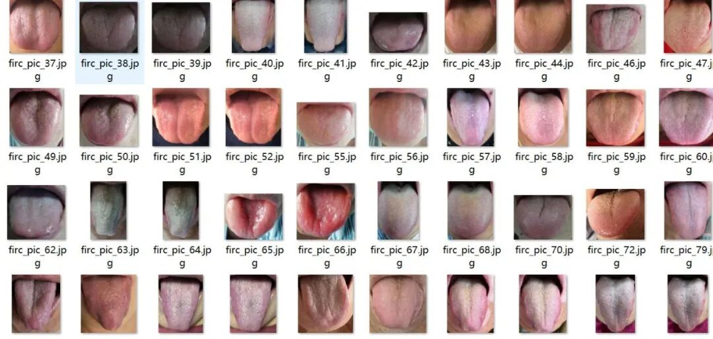
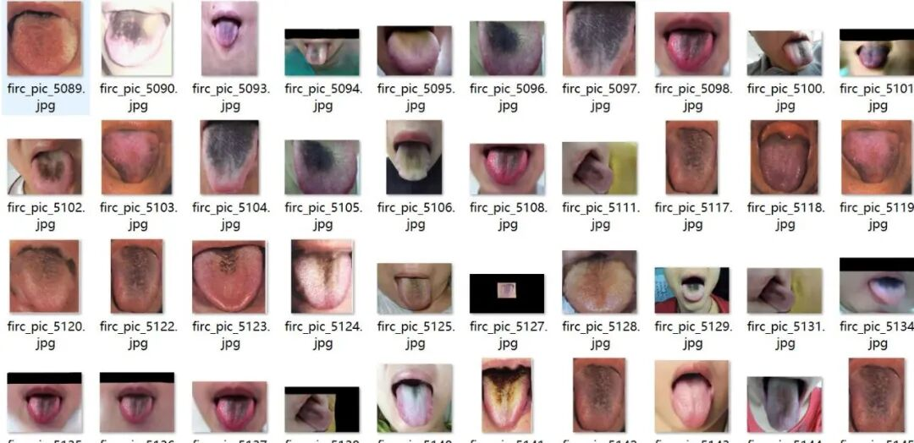
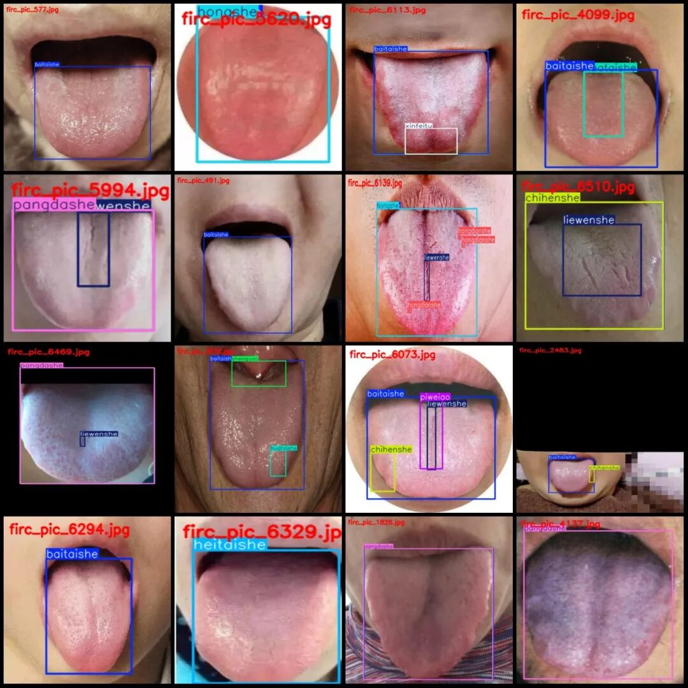
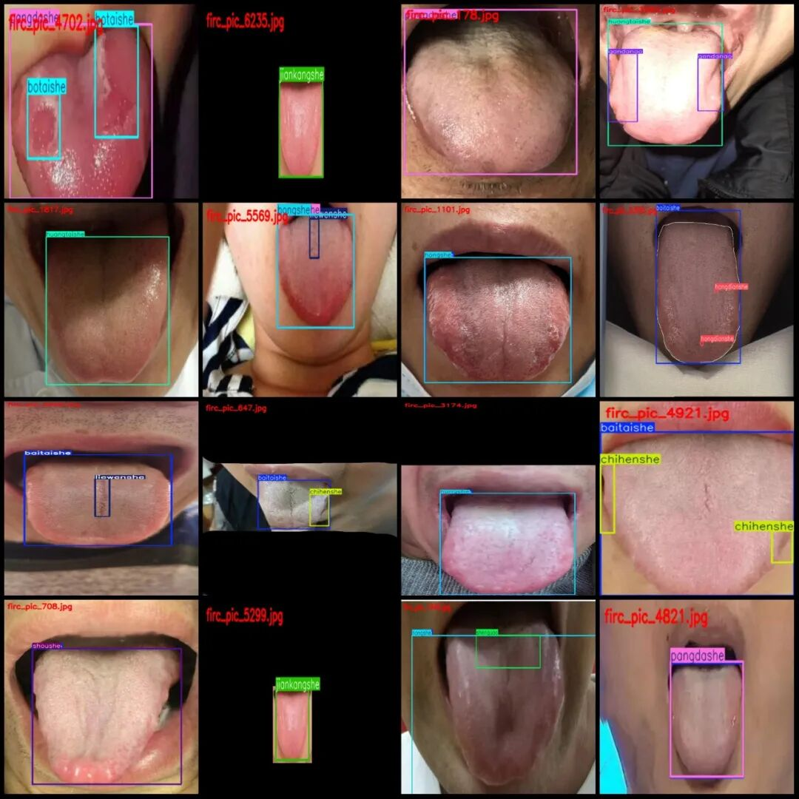

# The tongue diagnosis and disease detection dataset in VOC+YOLO format, 6522 images, 19 categories

Dataset format: Pascal VOC format + YOLO format (txt file without split path, only containing jpg images and corresponding VOC format xml files and yolo format txt files)

Number of images (number of jpg files): 6522

Number of annotations (number of xml files): 6522

Number of annotations (number of txt files): 6522

Labeling category count: 19

File compressed size: 282M

Label category names (Note that the order of labels in the YOLO format does not correspond to this, but is based on the "labels" folder's "classes.txt" file): ["baitaishe", "botaishe", "chihenshe", "gandanao", "gandantu", "heitaishe", "hongdianshe", "hongshe", "huangtaishe", "huataishe", "jiankangshe", "liewenshe", "pangdashe", "piweiao", "shenquao", "shenqutu", "shoushe", "xinfeitu", "zishe"]

["White tongue", "Puffy tongue", "Digitation tongue", "Thin and tender tongue", "Thin and dark tongue", "Black tongue", "Red spot tongue", "Red tongue", "Yellow tongue", "Flower-like peeling tongue", "Healthy tongue", "Cracked tongue", "Crumbling tongue", "Stomach and spleen dryness", "Tongue curling", "Tongue coiling", "Slim tongue", "Heart fire expulsion", "Purple tongue"]

Number of boxes labeled in each category:

baitaishe frame count = 5035

Botaishe Frame Count = 581

Chihenshe frame count = 1477

Gandanao Frames = 292

Gandantu Frames = 9

heitaishe frame count = 122

hongdianshe frame count = 3667

Hongshe Frame Count = 1467

Huangtaishe Frame Count = 1119

Huataishe Frame Count = 282

jiankangshe frame count = 21

Liewenshe frame count = 1886

Pangdashe Frame Count = 690

piweiao Frames = 187

Shenquao Frames = 493

shenqutu box count = 2

Number of frames = 285

xinfeitu frame count = 373

ZiShe Frame Count = 231

Total frame count: 18219

Number of images per category:

Baitaishe's possession of images = 4913

Botaishe's possession of images = 392

Chihenshe owns 1052 images.

Gandanao's possession of images = 189

Gandantu's number of images = 5

Heitaishe's number of images = 121

Hongdianshe owns 1229 images.

Hongshe owns 1436 images.

Huangtaishe's possession of images = 1109

Huataishe's possession of images = 241

Jiankangshe owns 19 images.

Liewenshe owns 1653 images.

Pangdashe's number of images = 685

Piweiiao has 179 images.

Shenquao's number of images = 480

shenqutu occupies the number of images = 2

Shoushe occupies the number of images = 283

xinfeitu's image count = 369

Zi She has 230 images.

Image resolution: Multiple resolutions such as 640x640, 4320x3240, etc.

Using labelImg:

Annotation rules: Draw a rectangle around the category.

Important Notice: The dataset does not have separate training, validation, and test sets; you need to partition them yourself.

Special : This dataset does not guarantee the accuracy of the trained models or weight files.

Image Preview:

Annotation example:

## Payment

Here is a pay link on Stripe ( https://buy.stripe.com/3cs8yP7sY87d0vu9AB ). Please contact me lonlonago@foxmail.com after funding $89, and I will send you a complete data files , thank you!

